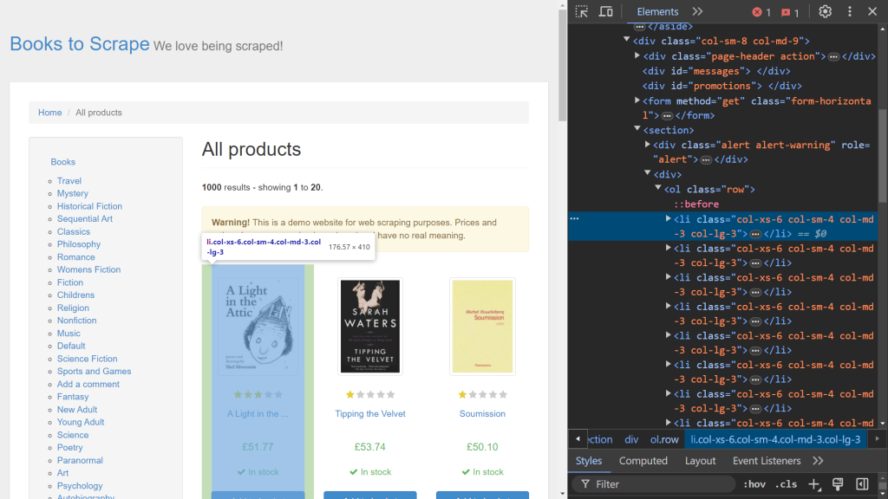
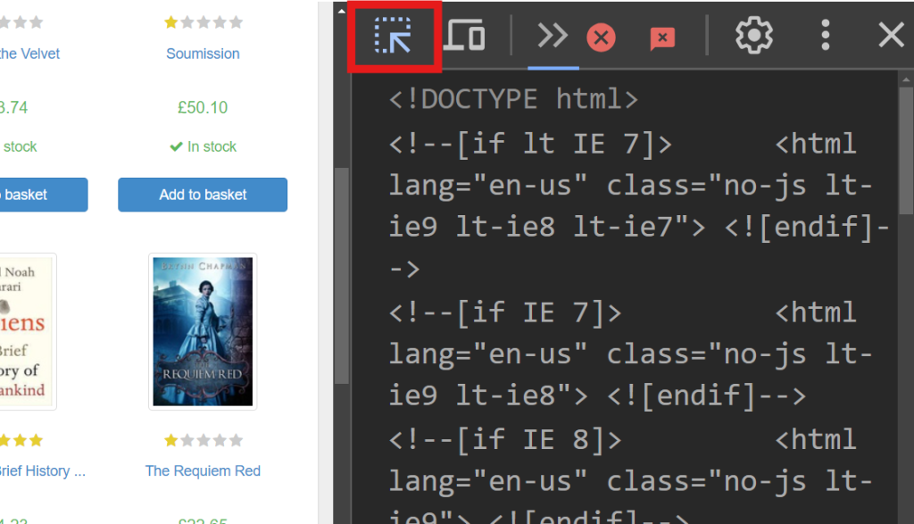
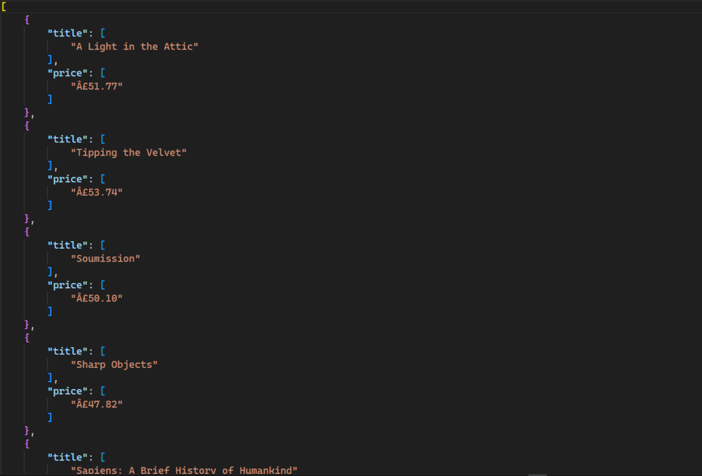
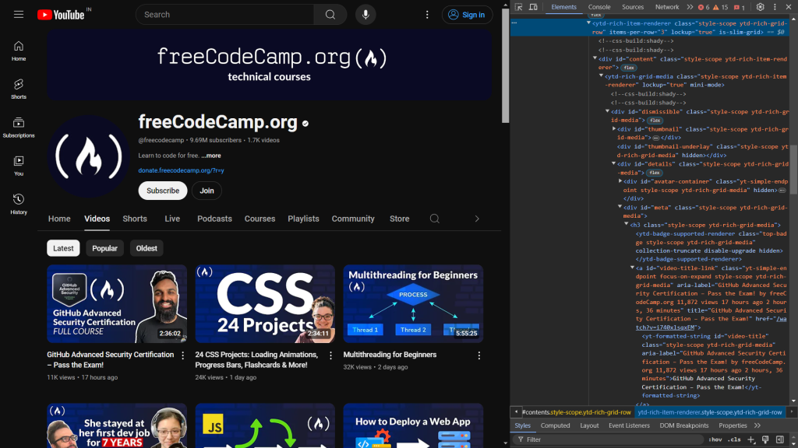
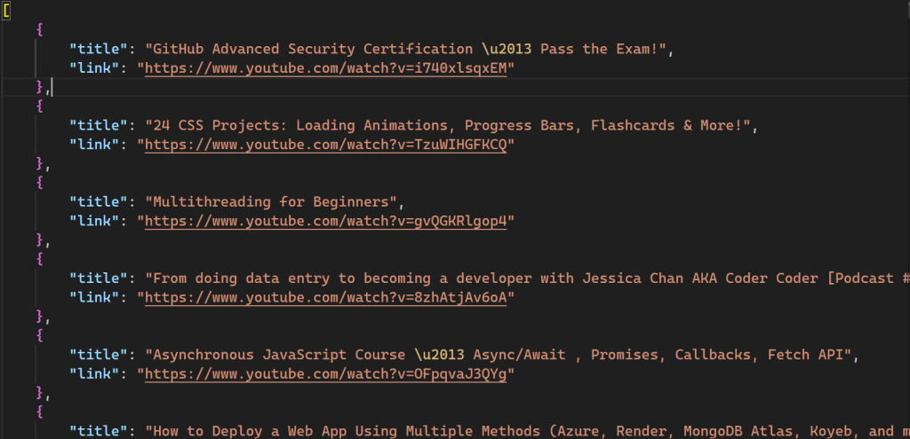
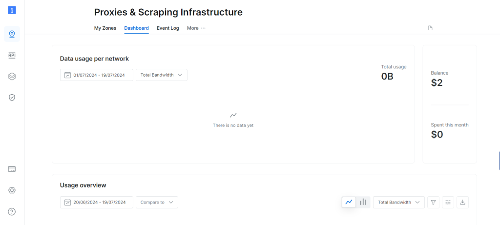

# 使用 lxml 进行网页爬虫

[](https://www.bright.cn/)

本指南介绍如何在 Python 中使用 `lxml` 软件包解析静态和动态内容、克服常见挑战，并简化数据提取流程。

- [在 Python 中使用 lxml 进行网页爬虫](#在-python-中使用-lxml-进行网页爬虫)
- [前提条件](#前提条件)
- [解析静态 HTML 内容](#解析静态-html-内容)
- [解析动态 HTML 内容](#解析动态-html-内容)
- [将 lxml 与 Bright Data 代理结合使用](#将-lxml-与-bright-data-代理结合使用)

## 在 Python 中使用 lxml 进行网页爬虫

在 Web 中，结构化和分层数据可以用两种格式表示：HTML 和 XML：

- **XML** 是一种基础结构，不提供预构建的标签和样式。开发者通过定义自己的标签来创建结构。标签的主要用途是创建可供不同系统理解的标准数据结构。
- **HTML** 是一种带有预定义标签的 Web 标记语言。这些标签具有一些样式属性，例如 `<h1>` 标签中的 `font-size`，或 `` 标签的 `display`。HTML 的主要功能是有效构建网页结构。

lxml 可以处理 HTML 和 XML 文档。

### 前提条件

在开始使用 lxml 进行网页爬虫之前，你需要在计算机上安装几个库：

```sh
pip install lxml requests cssselect
```

此命令会安装以下软件包：

- `lxml`，用于解析 XML 和 HTML
- `requests`，用于获取网页
- `cssselect`，使用 CSS 选择器提取 HTML 元素

### 解析静态 HTML 内容

可以抓取的 Web 内容主要分为两种：静态内容和动态内容。网页首次加载时，静态内容便已嵌入 HTML 文档中，因此很容易抓取。相比之下，动态内容会持续加载，或在页面首次加载后由 JavaScript 触发加载。

首先，使用浏览器的 **开发者工具** 找出相关的 HTML 元素。在 Chrome 中，右键单击网页并选择 **检查** 选项，或按 **F12**，即可打开 **开发者工具**。



屏幕右侧会显示负责渲染页面的代码。要找到处理每本书数据的特定 HTML 元素，请使用悬停选择功能（屏幕左上角的箭头）在代码中查找：



在 **开发者工具** 中，你应该会看到以下代码片段：

```html
<article class="product_pod">
<!-- code omitted -->
<h3><a href="catalogue/a-light-in-the-attic_1000/index.html" title="A Light in the Attic">A Light in the ...</a></h3>
            <div class="product_price">
        <p class="price_color">£51.77</p>
<!-- code omitted -->
            </div>
    </article>
```

创建名为 `static_scrape.py` 的新文件，并输入以下代码：

```python
import requests
from lxml import html
import json

URL = "https://books.toscrape.com/"

content = requests.get(URL).text
```

接下来，解析 HTML 并提取数据：

```python
parsed = html.fromstring(content)
all_books = parsed.xpath('//article[@class="product_pod"]')
books = []
```

此代码使用 `html.fromstring(content)` 初始化 `parsed` 变量，将 HTML 内容解析为分层树结构。`all_books` 变量使用 XPath 选择器，从网页中获取所有 class 为 `product_pod` 的 `<article>` 标签。此语法专用于 XPath 表达式。

接下来，遍历书籍并提取书名和价格：

```python
for book in all_books:
    book_title = book.xpath('.//h3/a/@title')
    price = book.cssselect("p.price_color")[0].text_content()
    books.append({"title": book_title, "price": price})

```

`book_title` 变量使用 XPath 选择器定义，该选择器从 `<h3>` 标签内的 `<a>` 标签中获取 `title` 属性。XPath 表达式开头的点（`.`）表示应从 `<article>` 标签开始搜索，而不是从默认起点开始。 

下一行使用 `cssselect` 方法，从 class 为 `price_color` 的 `<p>` 标签中提取价格。由于 `cssselect` 返回一个列表，因此通过索引（`[0]`）访问第一个元素，再由 `text_content()` 获取元素内的文本。 

随后，每组提取出的书名和价格都会以字典形式添加到 `books` 列表中，以便轻松存储到 JSON 文件中。

现在，将提取的数据保存为 JSON 文件：

```python
with open("books.json", "w", encoding="utf-8") as file:
    json.dump(books, file)
```

运行脚本：

```sh
python static_scrape.py
```

此命令会在你的目录中生成一个新文件，其输出如下：



此脚本的全部代码均可在 [GitHub](https://gist.github.com/vivekthedev/c1c5f0fb0e23cabfa3fa5c364b939f7c) 上获取。

### 解析动态 HTML 内容

要抓取动态内容，请安装 [Selenium](https://www.selenium.dev/)：

```sh
pip install selenium
```

YouTube 是使用 JavaScript 渲染内容的典型示例。我们将模拟键盘按键来滚动页面，从 [freeCodeCamp.org YouTube 频道](https://www.youtube.com/c/Freecodecamp)抓取排名前 100 的视频数据。

首先，使用 **开发者工具** 检查网页的 HTML 代码：



以下代码标识了负责显示视频标题和链接的元素：

```html
<a id="video-title-link" class="yt-simple-endpoint focus-on-expand style-scope ytd-rich-grid-media" href="/watch?v=i740xlsqxEM">
<yt-formatted-string id="video-title" class="style-scope ytd-rich-grid-media">GitHub Advanced Security Certification – Pass the Exam!
</yt-formatted-string></a>
```

视频标题位于 ID 为 `video-title` 的 `yt-formatted-string` 标签中，视频链接则位于 ID 为 `video-title-link` 的 `a` 标签的 `href` 属性中。

创建 `dynamic_scrape.py` 并导入所需模块：

```python
from selenium import webdriver
from selenium.webdriver.common.by import By
from selenium.webdriver.common.keys import Keys

from lxml import html

from time import sleep
import json

```

定义浏览器驱动程序：

```python
URL = "https://www.youtube.com/@freecodecamp/videos"
videos = []
driver = webdriver.Chrome()

driver.get(URL)
sleep(3)
```

与之前的脚本类似，你需要声明一个包含待抓取网页 URL 的 `URL` 变量，以及一个以列表形式存储所有数据的 `videos` 变量。 

接下来，声明一个用于与浏览器交互的 `driver` 变量（_即_ `Chrome` 实例）。`get()` 函数会打开浏览器实例，并向指定的 `URL` 发送请求。 

之后，调用 `sleep` 函数等待 3 秒，然后再访问网页上的任何元素，以确保所有 HTML 代码都已加载到浏览器中。

现在，模拟向下滚动以加载更多视频：

```python
parent = driver.find_element(By.TAG_NAME, 'html')
for i in range(4):
    parent.send_keys(Keys.END)
    sleep(3)
```

`send_keys` 方法模拟按下 `END` 键滚动到页面底部，从而触发加载更多视频。此操作会在 `for` 循环中重复 4 次，以确保加载足够多的视频。每次滚动后，`sleep` 函数都会暂停 3 秒，让视频完成加载后再继续滚动。

接下来，提取视频标题和链接：

```python
html_data = html.fromstring(driver.page_source)

videos_html = html_data.cssselect("a#video-title-link")
for video in videos_html:
    title = video.text_content()
    link = "https://www.youtube.com" + video.get("href")

    videos.append( {"title": title, "link": link} )
```

在此代码中，你将驱动程序 `page_source` 属性中的 HTML 内容传递给 `fromstring` 方法，由该方法构建 HTML 的分层树结构。 

然后，使用 CSS 选择器选取所有 ID 为 `video-title-link` 的 `<a>` 标签，其中 `#` 符号表示使用标签 ID 进行选择。此操作会返回满足给定条件的元素列表。 

随后，代码会遍历每个元素以提取标题和链接。`text_content` 方法获取内部文本（视频标题），而 `get` 方法则获取 `href` 属性值（视频链接）。 

最后，数据存储在名为 `videos` 的列表中。

现在，将数据保存为 JSON 文件并关闭驱动程序：

```python
with open('videos.json', 'w') as file:
    json.dump(videos, file)
driver.close()
```

运行脚本：

```sh
python dynamic_scrape.py
```

运行脚本后，你的目录中会创建一个名为 `videos.json` 的新文件：



此脚本的全部代码也可在 [GitHub](https://gist.github.com/vivekthedev/36489fbaf896eb7c06ebb9350dec298a) 上获取。

### 将 lxml 与 Bright Data 代理结合使用

网页爬虫可能会遇到反抓取工具和速率限制等挑战。代理服务器可以通过隐藏用户的 IP 地址来提供帮助。Bright Data 提供可靠的代理服务。

首先，注册免费试用，从 Bright Data 获取代理。创建 Bright Data 账户后，你将看到以下控制面板：



前往 **我的区域** 选项并创建一个新的[住宅代理](https://www.bright.cn/proxy-types/residential-proxies)。随后，你将看到代理用户名、密码和主机信息，下一步需要使用这些信息。

接下来，在 URL 变量下方添加以下代码，以修改 `static_scrape.py`：

```python
URL = "https://books.toscrape.com/"

# new
username = ""
password = ""
hostname = ""

proxies = {
    "http": f"https://{username}:{password}@{hostname}",
    "https": f"https://{username}:{password}@{hostname}",
}

content = requests.get(URL, proxies=proxies).text
```

将占位符替换为你的 Bright Data 凭据，然后运行脚本：

```sh
python static_scrape.py
```

运行此脚本后，你将看到与上一个示例类似的输出。

你可以在 [GitHub](https://gist.github.com/vivekthedev/201f994bc14e4dbc7263b03983f917b3) 上查看完整脚本。

## 总结

在 Python 中使用 lxml 可以高效进行网页抓取，但这一过程可能很耗时。Bright Data 提供了更高效的替代方案，包括开箱即用的[数据集](https://www.bright.cn/products/datasets)和[网页爬虫工具 API](https://www.bright.cn/products/web-scraper)。

免费试用 Bright Data！
